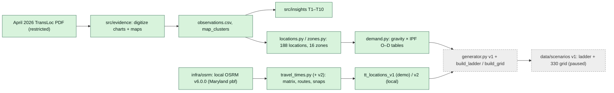
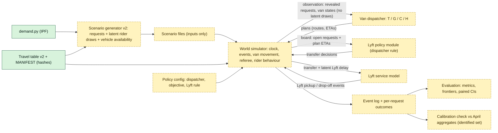

# Mathematical design and architecture (v0.1 draft, 12 Oct 2026)

**Status:** this is a **proposal**. Nothing here is implemented; the simulator and dispatchers are Phase 4 and need separate approval.

**Sources:**
- `research_review.md` (direction and assumptions);
- `research_notes/math_literature.md` (formulation details, 37 sources, verification levels);
- `transloc_operations.md` §3.2 (the 2016 TransLoc engine).

Wherever a choice is ours rather than evidence, it is marked **ASSUMED** or **PROPOSED**.

---

## 1. The model in plain words
Picture a referee and two kinds of player.
- **The referee (the world simulator)** keeps the clock, moves vans along road times, and decides what riders do. A rider gives up if they wait too long, or doesn't show up.
- **The van dispatcher (the algorithm)** looks at every rider not yet picked up and every van. It works out who each van should pick up and in what order. It does this whenever something happens (a booking, a cancellation, a no-show) and **every two minutes** anyway, and it may move a not-yet-picked-up rider to another van.
- **The Lyft rule (the human dispatcher's policy)** looks at the same board and decides which waiting riders to hand to Lyft, and when.

**What "good" means for the van dispatcher:**
- a waiting minute costs more the longer someone has already waited (a **convex penalty**);
- a minute on board costs less than a minute of waiting;
- driving costs a little;
- no rider may be kept on board unreasonably long (a **ride guardrail**).

**The study:** we change only the Lyft rule, hold everything else fixed, replay the same nights, and compare waits, cancellations and resource use.

---

## 2. Is this the right mathematical framing?
**Yes:** a **dynamic (online) dial-a-ride problem**, solved by **rolling-horizon re-optimization**.
- Requests arrive over time (unknown in advance), each with a pickup and a drop-off, served by capacitated vehicles under precedence and ride-time conditions.
- The plan is re-solved on events and periodically, and only the next move of each van is executed.

The literature treats this as standard:
- **dynamic DARP surveys:** Berbeglia, Cordeau & Laporte 2010; Ho et al. 2018 (abstract-level access only);
- **the original insertion heuristic:** Jaw et al. 1986;
- **assignment on a shareability graph:** Alonso-Mora et al. 2017.

TransLoc's 2016 description fits it.

**What the combination "event + periodic re-plan + convex wait penalty + Lyft rule" was still missing:**
1. A **state definition** with onboard and near-pickup commitments.
2. **Hard rules vs penalties:** capacity, precedence, the ride guardrail and shift ends.
3. The **price of leaving a request unassigned.** Without it, the optimizer can starve old requests.
4. **End-of-night** treatment.
5. An **information rule:** no peeking at future requests.
6. **Exact definitions** of wait, ride and detour that are identical across modes.
7. How the **Lyft rule interfaces** with the plan.
8. A **latency rule** for solves that overrun.

§§3–7 fill these in.

---

## 3. Formal model

### 3.1 Time, information, events
- **Simulation time** is in integer seconds from 18:00.
- **Requests are revealed at their request time t_r.** A policy acting at time τ may use only requests with t_r ≤ τ, the current van states, and **non-realised** knowledge:
  - travel tables;
  - published service rules;
  - the scenario's *aggregate* parameters (e.g. an hourly rate), if a forecast-using variant is ever tested. Such a forecast must come from an independent estimate, never the generator's own realised draws (literature note R-11).
- **No policy sees** future requests or riders' latent draws (patience, no-show, consent, Lyft delay). The only exception is the labelled clairvoyant benchmark H.
- **Events:** request, cancellation, van arrival at a stop, pickup, drop-off, no-show (after the 3-min wait), Lyft transfer decision, Lyft pickup, Lyft drop-off, van shift start/end, periodic tick (Δ = 120 s).
- **Dispatcher re-solves** on request, cancellation, no-show and transfer events, and on each tick.
- **Stop arrivals and departures** update the state but do not trigger a re-solve.

### 3.2 State at decision epoch τ
| Symbol | Meaning |
|---|---|
| V(τ) | Vans available at τ (from the availability profile) |
| n_v, a_v | Van v's **committed next node** and its arrival time there. No mid-edge diversion (ASSUMED) |
| E_v | Van v's shift end. After E_v: no new pickups, finish onboard riders (and committed pickups) |
| Q_v | Seats (10–14, AS-15) |
| O_v | **Onboard parties** (sunk pickup time p_r; fixed to v) |
| C_v | **Committed pickups**: the van's next stop, or the van is at the curb in its 3-min wait. Fixed to v |
| R(τ) | **Open requests**: revealed, not picked up, not committed, not cancelled, not transferred. Assigned-but-uncommitted requests are in R and **may be reassigned** |
| t_r, o_r, d_r, q_r | Request time, origin, destination, party size (1–5) |
| T(i,j) | Road time: OSRM free-flow seconds × multiplier m (AS-21) |
| s | Dwell per stop (30 s, ASSUMED) |

### 3.3 Decisions (one epoch)
**Recommended: route selection over feasible candidate routes.** This follows the Alonso-Mora pattern; full detail is in the literature note §2.2.
- For each van v, build candidate routes k. Each is an ordered stop list starting at n_v that contains all of O_v's drop-offs, C_v's pickup and drop-off, and a subset S_k of open requests (pickup before drop-off).
- Always include the "committed work only" route, so a feasible solution always exists.

Variables:
- y_vk ∈ {0,1}: van v uses route k;
- u_r ∈ {0,1}: open request r is left **unassigned (pending)** this epoch.

```
min  Σ_v Σ_k c_vk·y_vk + Σ_r π_r·u_r
s.t. Σ_k y_vk = 1                      ∀ v        (one route per van)
     Σ_{v,k: r∈S_k} y_vk + u_r = 1      ∀ r ∈ R    (each open request: one van, or pending)
     y, u binary
```

**Constraints enforced when routes are built:**
- **capacity:** the running load is never above Q_v;
- **precedence and pairing:** same van, pickup first;
- **onboard and committed work:** kept, with the committed stop first;
- **shift end:** no new pickup whose drop-off ends after E_v + g, a grace period (ASSUMED);
- **the ride guardrail** (§4.3).

**Forward schedule:** each candidate is simulated forward. A van departs a stop as soon as service ends, and never idles on purpose (ASSUMED). This gives each rider's pickup P_r and drop-off D_r.

**Restricted candidate set.** For tractability, a route may add at most a few new requests per epoch, and only the best sequences per subset are kept. The exact player C is then "**optimal over the enumerated candidates**", which is stated in every report.

### 3.4 Definitions (identical for every policy and both modes)
| Quantity | Definition |
|---|---|
| **Wait** W_r | **Actual pickup time − request time t_r.** For a Lyft-transferred rider, pickup is the **Lyft** pickup. **A transfer never resets the clock** |
| **Ride time** H_r | Drop-off − pickup |
| **Direct time** T_r | T(o_r, d_r) × m |
| **Detour ratio** | H_r / T_r |
| **Party size** q_r | Passengers in the booking. Costs and metrics are **passenger-weighted** (the dashboard counts riders), with request-weighted versions also reported |

### 3.5 Route cost
```
c_vk = Σ_{r∈S_k∪C_v} q_r·φ(W_r)  +  β·Σ_{r on route} q_r·H_r  +  γ·km_k  +  Ψ·Σ_r q_r·(H_r − L_r)⁺
```
- **φ** is the convex wait penalty (§4.1), evaluated on the **total** wait from t_r, so sunk waiting counts and old requests are prioritised.
- **β** is the ride weight, **γ** a small distance weight.
- **Ψ** is a very large penalty above the ride guardrail L_r (§4.3).
- **All terms are in passenger-minutes,** so the weights are comparable exchange rates: γ is minutes per km.

**Pending price π_r** = q_r·φ(W_r^next) + M, where W_r^next is the wait if r is picked up no earlier than the next epoch, and M is large.
- So any feasible assignment beats leaving r pending. Every request gets a plan and an ETA, as TransLoc does.
- A request stays pending only when no candidate route can take it. **This must be fixed for all players** (literature note R-4); a weak π_r lets a solver look good by starving hard requests.

---

## 4. Priorities: convex waiting, ride guardrail, weighting

### 4.1 The convex wait penalty φ
**What the evidence pins down.** TransLoc's 2016 example prefers cutting 1 min from a 10-min wait over 2 min from a 5-min wait: φ(10) − φ(9) > φ(5) − φ(3). [checked]
- A **linear** φ fails this (1 > 2 is false).
- A power law w^p needs **p > 1.80**; at p = 1.8 the two sides are equal, and at p = 2 they are 19 vs 16.

**Proposed φ (piecewise linear, convex; ASSUMED).** Slopes per passenger-minute:

| Wait range (min) | 0–5 | 5–10 | 10–15 | 15–20 | > 20 |
|---|---|---|---|---|---|
| Slope | 1 | 2.5 | 5 | 10 | 20 |

- It passes the TransLoc check: 2.5 > 2. A slope of exactly 2 on 5–10 would fail it.
- The break-points at 15 and 20 tie the steepening to the published Homewood targets (pickup 15; busy-time 20).
- **Only the 3–10 min region is constrained by evidence; the rest is our choice.**
- Variants: gentler (halve the slopes above 10) and steeper (double them).

**Representation:**
- In the **route-selection model** φ is evaluated outside the solver while route costs are computed, so the MILP stays **linear** whatever φ looks like.
- In a **node-arc model** (used only for the hindsight benchmark H), wait is a continuous variable. φ then enters as a **piecewise-linear epigraph**: θ_r ≥ φ(b_j) + σ_j(W_r − b_j) for each piece, minimizing Σ q_r θ_r. This is exact for the piecewise-linear φ and needs **no extra binaries**, because φ is convex and minimized.
- A **quadratic** φ = W² would make the model a **MIQP**, not a MILP. HiGHS does not handle that (SECONDARY), so it is not proposed.

### 4.2 Weighted vs lexicographic
| | Weighted (recommended) | Lexicographic (variant "strict safety-first") |
|---|---|---|
| Meaning | An explicit exchange rate: past ~5 min of waiting, a waiting minute costs more than a riding minute | No amount of ride time is worth one second of wait |
| Risk | The weights are arbitrary, so they are swept | **Unbounded onboard detours**, the long-ride tail behind April's P90 ride of 24 min and the student complaints |
| Computation | One solve per epoch | 2–3 solves per epoch; stage ties flip easily under re-planning |

**Recommendation:** weighted, with **β = 0.5** (a riding minute = half a waiting minute at the base slope; ASSUMED; sweep 0.25 / 0.5 / 1) and γ small (e.g. 0.1 min/km; ASSUMED). This expresses **safety-first (waiting matters more) as a marginal priority, not an absolute one.** The lexicographic variant is kept to show the frontier.

### 4.3 The ride guardrail (no unreasonable onboard delays)
**Hard-but-elastic cap:** L_r = max(L_abs, α·T_r + δ), with L_abs = 25 min, α = 2 and δ = 5 min (all ASSUMED; the form follows the literature, with the citation detail unverified).
- **Not 20 min, the published target.** A hard 20 would be stricter than the service delivers (April P90 is 24 min on completed rides), and with long Homewood–Peabody trips it could make some epochs infeasible.
- **Elastic:** violations are allowed only at penalty Ψ, logged, and reported. Ideally there are none.
- **The 20-min target is a reporting threshold** (share of rides over 20 min).
- Variants: L_abs 20 (hard target) and 35 (loose).

### 4.4 Service quality is not safety
- Shorter outdoor waits at night are a **service-quality proxy** for the safety purpose of the program.
- The model measures waits, cancellations and ride times. It does **not** measure physical safety outcomes. Reports must use the proxy language.

---

## 5. Rolling horizon details
| Element | Proposal |
|---|---|
| **Triggers** | Request, cancellation, no-show, Lyft transfer, plus a **periodic tick Δ = 120 s** (VENDOR 2016). **Cadence is identical across compared players**; it is varied only as a stated policy/sensitivity (60 / 120 / 300 s) |
| **Horizon** | All currently known work (open + committed + onboard). No look-ahead beyond revealed requests |
| **What is executed** | Only each van's next stop. The rest is a plan the next solve may change |
| **Commitments** | Onboard riders are fixed to their van. A van's **next stop is frozen** (the tablet "next stop"); a van waiting at the curb is committed for the 3-min wait. Variant: commit when ETA ≤ 5 min |
| **Reassignment** | Allowed for open (uncommitted) requests. Variants: none, or a penalty η per changed assignment. **ETA churn is reported**: the number of times the predicted pickup moved by more than 1 min, and the largest change |
| **Unassigned requests** | Stay pending with the price π_r (§3.5); always visible to the Lyft rule |
| **End of night** | No requests after 02:00; requests made before 02:00 are honoured. The run ends when every accepted request is resolved (completed by van or Lyft, cancelled, or no-show). Report the backlog after 02:00 (van-minutes, last drop-off). Vans whose shift ends cannot take new work (§3.3) |
| **Future demand** | Policies are myopic (TransLoc-like). The clairvoyant **H** is the only exception: tiny instances, no cancellations, or patience as known deadlines, and the same Lyft rules if Lyft is used |
| **Latency rule** | Each solve has a deterministic budget (iterations/nodes) and a wall-clock safety cap of ≤ Δ/4. **If a solve overruns: keep the previous plan, insert new requests greedily, and log it.** Simulated time is not frozen while a solver thinks |

---

## 6. Players (van dispatchers) and the Lyft policy module

### 6.1 Van dispatchers (the algorithm dimension)
| Player | Definition | Role |
|---|---|---|
| **T, TransLoc-like** (baseline) | §3 model, solved by **insertion + local search** (relocate and exchange moves, or an annealing schedule) with a fixed iteration budget; event + 120 s; reassignment of open requests | Held **fixed** in all Lyft-policy comparisons |
| **G, greedy** | Insert each new request at its cheapest position on arrival; never reassign | Floor; robustness check (SQ1) |
| **T−** | T without reassignment, and/or a 300 s cadence | Baseline-uncertainty variant (AS-02) |
| **C, epoch-exact** | §3 model solved exactly (HiGHS) over the enumerated candidates | Per-epoch reference on small instances only (L1–L4) |
| **H, hindsight** | Node-arc MILP with full knowledge of the (tiny) night | Information bound; L1 only; reported as [incumbent, bound] |

**Fair comparison of algorithms:**
- the same objective, constraints, cadence and commit rule;
- the budget matched by iterations/nodes (reproducible) and reported in wall time too;
- "optimal" is claimed only with a closed gap.

**Two limits on what this shows:**
- **Per-epoch optimality ≠ whole-night optimality.**
- **T ≈ C in structure, not in solver.** A C − T gap measures the solver only, because the model is shared.

### 6.2 Lyft policy module (the policy dimension)
**Kept separate from the dispatcher (recommended):**
- it is what Hopkins does: a human dispatcher;
- it keeps "policy" apart from "algorithm";
- it is interpretable;
- it needs **no dollar price** for a Lyft trip.

**Trade-off.** An integrated model (Lyft as a third option inside the solve, at cost κ) can pick the trips that are expensive for the fleet rather than merely late (Grahn et al. 2023; outsourcing literature). But κ has no defensible value, and integrating the rule changes the algorithm too. The integrated variant is therefore **deferred** and, if run, swept over κ as a shadow price.

**How the module runs.** It runs after each dispatcher solve. It sees each open request's t_r, q_r, assignment state and predicted van pickup P̂_r from the current plan. It cannot see latent draws.

**Every rule shares these mechanics:**
- **eligibility:** not committed or onboard; parties of 1–4 use a standard Lyft, parties of 5 a Lyft XL, kept together (D-33, 21 Oct; XL delay, availability and cost unknown, same latent delay in the base);
- **consent:** a latent per-request draw against probability p_c;
- **dispatcher lag ℓ:** from decision to the Lyft request being placed;
- **Lyft pickup** at decision + ℓ + L_r, where L_r is a latent per-request Lyft delay;
- **Lyft ride:** direct, T_r × m_L;
- **optional dispatcher capacity:** at most k transfers per 10 min, oldest first.

The rules themselves are defined in `scenario_spec.md` §6.

---

## 7. Outcomes and metrics
Each request ends in exactly one terminal state. These are **kept separate in the model**, even where Hopkins' dashboard merges them:
- van-completed;
- Lyft-completed;
- rider cancelled while pending with the van;
- rider cancelled after the Lyft transfer (during lag or the Lyft wait);
- van no-show;
- Lyft no-show;
- unresolved at close (should be 0).

A transfer is **not** a completion.

**A dashboard-comparable view** is derived for calibration only: Completed = van-completed; "Canceled" = rider cancellations + Lyft transfers (variant: rider cancellations only).

**Metrics (all paired across policies on the same nights):**
- **wait** P50/P90/P95, passenger-weighted, across both modes;
- **share waiting > 15 min** (and > 10 and > 20). Abandoned requests count as late if they abandoned after the threshold;
- **cancellation rate**, and the completed-service rate;
- **ride time** P90, detour ratio P90, share of rides over 20 min, guardrail violations;
- **Lyft trips and Lyft passengers** per night; Lyft km;
- **van-km** (loaded and empty); van-hours are fixed by the availability profile;
- **ETA churn**; maximum pending age; backlog after 02:00;
- **subgroups:** party size (parties of 5 need a Lyft XL; XL trips reported separately) and zone (Homewood core vs Peabody area).

**Better** means a point on the **frontier of rider outcome (e.g. P90 wait, share > 15 min) against resource use (Lyft trips)**. "Send everyone to Lyft" is just one end of that frontier, never the answer. Dollar costs appear only as labelled illustrations with stated price ranges.

---

## 8. Architecture

### 8.1 Current (implemented through 2 Oct)


### 8.2 Proposed (Phase 3 v2 → Phase 4; not implemented)


### 8.3 Responsibilities and information flow
| Component | Owns | Must not |
|---|---|---|
| **Scenario generator** | Inputs only: request times, O/D, party size, availability profile, and per-request **latent draws** (patience, no-show, consent, Lyft delay, ETA noise) from separate seeded streams | Decide anything that depends on a policy (no pre-computed outcomes) |
| **Travel tables / OSRM** | Road times, distances and route shapes, fingerprinted (pbf md5, image digest, matrix sha256) | Be called at simulation time (the simulator reads the matrix file) |
| **World simulator (referee)** | Clock, event order, van movement, dwell, rider behaviour (apply latent draws when the event occurs), accounting, constraint checks on every plan | Optimize; leak latent draws or future requests to policies |
| **Van dispatcher** | Plans from the observation it is given | See the future; touch Lyft |
| **Lyft policy module** | Transfer decisions from the observable board and its rule parameters | See latent draws |
| **Lyft service model** | Lyft pickup and drop-off times from latent delays and travel tables | Pool or reject (unless a scarcity variant says so) |
| **Evaluation** | Metrics, paired comparisons, frontiers, calibration checks | Change policies after seeing results (no post-hoc tuning) |
