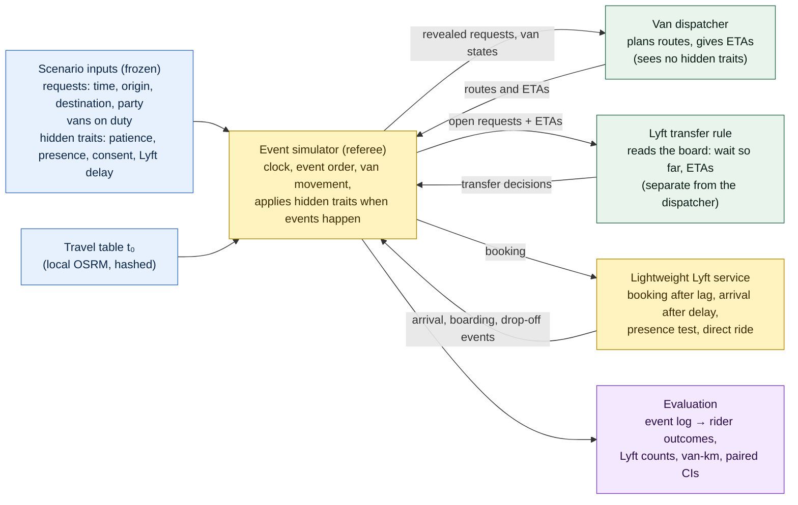

# Scenario-design methodology and build contract (v1.0, 21 Oct 2026)

**What this is.** This document explains how the simulated Night Ride evenings are built from April 2026's aggregate dashboard, what each design choice rests on, and what has to be built next. It is the methodology material planned in Phase 3 plan v4. It reflects the consolidation review of 21 Oct 2026, whose decisions are D-45 to D-51 in the decision log.

**How to read it.** The core (§1–§9) is meant to be read straight through. The appendices hold the arithmetic, the full reconciliation register and the document map.

**Which document governs what:**

| Question | Authoritative document |
|---|---|
| What was decided, when and why | `decision_log.md` (wins any conflict) |
| What the simulator must do: inputs, states, event order, outputs | `scenario_spec.md` v0.4, especially **§17 (build contract)** |
| The mathematics of the dispatcher and the Lyft rules | `model_design.md` v0.2 |
| Why the scenario looks the way it does | this document |
| How results will be judged | `preregistration_v2.md` (draft) |

---

## 1. Verdict on the direction
**The direction still supports the research question.** The question is: holding the van dispatcher fixed, which dispatcher-initiated Lyft transfer rule gives riders the best outcomes for the resources it uses (Lyft bookings, van-km)?

The scenario design keeps three things apart:
- **inputs** that are identical for every rule;
- the **policy**, which is the only thing that changes;
- **outcomes**, which only the simulation produces.

That separation is what makes a paired comparison of rules valid.

**Pushback, kept short:**
1. **Nothing has been simulated yet.** Every scenario so far is an input file plus an answer key computed by the generator. No dispatcher, MILP or Lyft module has run. Statements about "what the model does" are design statements, not results.
2. **The held-fixed dispatcher is not decided** (D-51). Until it is, the experiment has no defined baseline. My recommendation is in §8.
3. **The 168 requests are a derived workload, not April demand.** The count follows from a load-per-van assumption and a fleet denominator that mixes services. The design is honest about this (an illustrative range of ~150–260), but results must be stated "at the scaled system's density".
4. **Money is out** (D-45). This is the right call: Hopkins' cost per Lyft trip is unknown, and a rider's app showing no charge only says Hopkins pays, not what it pays. Results are about rider outcomes against counts of Lyft bookings and van-km.

---

## 2. The system in one picture

**In words:**
- The **simulator** is the referee. It owns the clock and decides what happens, applying each rider's hidden traits only when the relevant event occurs.
- The **van dispatcher** plans from what a real dispatcher could see.
- The **Lyft rule** is a separate module that reads the dispatcher's board. Keeping it separate is what lets us vary the rule while holding the dispatcher fixed.
- The **Lyft service** is deliberately thin: we need *when* a transferred rider is picked up, not how Lyft matches drivers.

---

## 3. What is put in, what is observed, what is hidden, what comes out
| Kind | Examples | Who can see it | Where it comes from |
|---|---|---|---|
| **Input (public)** | Request time, origin, destination, party size; vans on duty | The dispatcher sees a request only once it arrives | Scenario generator, from April aggregates |
| **Input (hidden)** | Patience deadline, presence draw U_r, consent draw, Lyft delay | Only the simulator, and only when the event happens | Scenario generator, separate seeded streams |
| **Policy** | Dispatcher, objective weights, cadence, Lyft rule, lag ℓ | Fixed per run | Policy file |
| **Observed (by the model's agents)** | Waiting so far, current plan, ETAs, pending requests | Dispatcher and Lyft rule | Produced by the simulation as it runs |
| **Produced (outcomes)** | Actual waits, pickups, cancellations, no-shows, transfers, Lyft completions, van-km | Evaluation | The simulation only; never pre-assigned |
| **April evidence (calibration targets)** | Completed / Canceled / No-show shares, wait and ride percentiles, rides per van-hour | The team | The restricted April PDF, via digitized aggregates |

**A scenario blueprint describes inputs and behavioural rules.** Cancellations, no-shows, transfers and completions are things the simulation produces. They are not typed in.

---

## 4. The design chain: evidence → derived quantity → design choice → limitation
| Block | April evidence | Derived quantity | Design choice | Limitation |
|---|---|---|---|---|
| **Arrival window** | Hourly chart of completed rides | Peak at 18:00–21:00 | Requests arrive **18:00–21:00**; the run continues until all accepted work is resolved | The full night (L7) is a later case |
| **Volume** | Requests 50,297; completed 24,095; average vehicles by hour ("All services") | R/C = 2.087; load per van ρ = 12.85 / 10.10 / 10.71 for the three hours | N_h = ρ_h × vans_h, largest-remainder rounding: **64 / 50 / 54 = 168** at 5 constant vans (D-35, D-36) | The vehicle count mixes services, and the chart averages 29 days. **Illustrative ~150–260**, not a confidence interval (D-49) |
| **Timing within the hour** | Hourly totals only | Fixed count per hour | Uniform random times within each hour | Within-hour bunching is not observed; the **burst** pattern stresses it |
| **Fleet** | ~27.6 "All services" vehicles at 6 pm, tapering | — | **5 vans × 14 seats**, constant 18:00–21:00, then on duty until the backlog is done (D-36). The sixth van is tested on the **same** requests (D-37) | A scaled-down system has fewer pooling chances per square mile |
| **Geography** | Density maps with printed bubble counts | 188 hotspot points, 16 zones | Door-to-door at snapped curb points; Homewood + Peabody, no East Baltimore (D-27); **no forced stops** | A bubble stands for many addresses. The dispersed variant spreads the 19 coarse clusters into 6 road satellites each (302 points) to test that (D-34) |
| **O–D pairing** | Origin totals and destination totals per zone, not pairs | Gravity × IPF table that reproduces both margins | Pairs drawn from that table (β_geo = 0.1 per min) | The true pairing is **not identified**: many tables share the same margins |
| **Party size** | 1.386 passengers per completed booking | — | Assumed P(1–5) = .73/.18/.055/.025/.01, mean 1.405 (D-38). Parties of 5 go by **Lyft XL** if transferred (D-33) | The shape is assumed; only the mean is near the data, and the two are different quantities |
| **Patience** | "Canceled" ≈ 47% of requests, which mixes rider cancellations and Lyft hand-offs | A rider share of "Canceled" of **50–75%** (sensitivity, not exhaustive) | A personal deadline (Weibull 1.5, median 18 min **placeholder**); a vehicle arrival ends the clock (D-39) | Patience is **not identified** by aggregates; calibration keeps a set of values, not one |
| **No-shows** | No-show ≈ 4.7% of **all** requests | ≈ 8.9% **per van arrival** under the status mapping | A rider is absent if U_r < p at the first vehicle arrival; **one p for every mode**; 180-s wait (D-40, D-48) | The 8.9% holds only if the mapping holds. Equal p across modes is assumed |
| **Lyft service** | JHU page: the dispatcher sends the Lyft; texts; ≤ 3-min wait | — | Decision → booking after lag 2 min → arrival after a lognormal delay (median 8, P90 15) → presence test → direct ride (D-43, D-46) | No Hopkins data on delays, failures or XL. **No prices** (D-45) |

---

## 5. Why the aggregates cannot pin down one scenario
The April dashboard gives **totals and shares**: requests by status, rides by hour, bubbles by place, a few percentiles. It never shows one rider's request, wait and outcome together. That has three consequences.

1. **Many different nights produce the same totals.** The same zone totals fit many O–D tables; the same hourly counts fit many within-hour patterns. We pick a principled member (maximum-entropy IPF; uniform times) and test stressed alternatives (far-trip, burst, dispersed geography). We do **not** claim it is *the* April night.
2. **Behaviour is confounded with operations.** A long wait followed by "Canceled" could be an impatient rider or a dispatcher hand-off to Lyft. The totals cannot separate them, which is why the rider share of "Canceled" is a 50–75% **range**, and why patience is calibrated to a **set** of values, not a single one.
3. **Shares do not say who.** "4.7% of requests were no-shows" says nothing about which riders, or whether presence depends on how long they waited. The model's per-arrival probability follows from the totals **only under a stated mapping** (Appendix C).

**So the claim the study can make is conditional:** "in scenarios consistent with April's aggregates, rule X does better than rule Y, and this holds across the identified set and the stress patterns." It cannot claim that rule X would have done better on 15 April.

---

## 6. The dispatcher's objective, one block at a time
The van dispatcher chooses one route per van. A route's score is a sum of four penalty terms, in **penalised passenger-minutes** ("points"). Lower is better. **These are priorities, not money.**

**Block 1: waiting, convex.** Each passenger's total wait W (from the original request, so sunk waiting counts) is charged φ(W):

| Wait (min) | 0–5 | 5–10 | 10–15 | 15–20 | > 20 |
|---|---|---|---|---|---|
| Points per extra minute | 1 | 2.5 | 5 | 10 | 20 |

So φ(5) = 5, φ(10) = 17.5, φ(15) = 42.5, φ(20) = 92.5. The longer someone has waited, the more each further minute costs.

**Block 2: riding.** β × ride minutes, with **β = 0.5** points per passenger-minute. With β = 0.5 and φ′ ≥ 1, a waiting minute always outweighs a riding minute.

**Block 3: driving.** γ × route km, with **γ = 0.1** points per km. It is a small tie-breaker that discourages pointless driving.

**Block 4: the ride guardrail.** G_r = max(25 min, 2 × direct time + 5 min). No route may create or increase a ride over G_r. A violation already locked into committed work is charged Ψ (very large) per passenger-minute over the guardrail and logged.

**Leaving a request pending** costs π_r = q_r · φ(W^next) + M, with M large. So the solver first serves as many requests as it can within its candidate routes, then minimises points. A request can still be left pending when routes compete for it or the candidate cap leaves it out. It then keeps a tentative ETA and a logged reason (D-47).

**Symbols:**

| Symbol | Meaning | Unit |
|---|---|---|
| q_r | Passengers in booking r | passengers |
| W_r | Pickup time − request time (either mode) | min |
| H_r | Drop-off − pickup | min |
| t₀(i,j) | Matrix travel time, unscaled | s |
| m_v, m_L | Van and Lyft travel multipliers, each applied once | — |
| φ | Convex wait penalty | points per passenger |
| β, γ | Ride weight; distance weight | points per passenger-min; points per km |
| G_r, Ψ, M | Guardrail; guardrail penalty; pending constant | min; points per passenger-min; points |

### Worked example (dwell omitted for clarity)
One empty van; two open requests:
- **r1:** 1 passenger, has already waited 8 min;
- **r2:** 2 passengers, has waited 1 min.

Both routes below are 10 km.

**Route A: r1 first.** Drive 4 min to r1, 3 min to r2, 5 min to r1's destination, 4 min to r2's.
- Waits: W1 = 8 + 4 = 12; W2 = 1 + 7 = 8.
- Rides: H1 = 3 + 5 = 8; H2 = 5 + 4 = 9.
- Waiting: 1 · φ(12) + 2 · φ(8) = 1 · 27.5 + 2 · 12.5 = 52.5.
- Riding: 0.5 · (1 · 8 + 2 · 9) = 13.0.
- Driving: 0.1 · 10 = 1.0.
- **Total 66.5.**

**Route B: r2 first.** Drive 5 min to r2, 3 min to r1, 5 min to r1's destination, 2 min to r2's.
- Waits: W2 = 1 + 5 = 6; W1 = 8 + 8 = 16.
- Rides: H1 = 5; H2 = 3 + 5 + 2 = 10.
- Waiting: 1 · φ(16) + 2 · φ(6) = 1 · 52.5 + 2 · 7.5 = 67.5.
- Riding: 0.5 · (5 + 2 · 10) = 12.5.
- Driving: 1.0.
- **Total 81.0.**

**The dispatcher picks A.** The rider who has already waited 8 min goes first, even though r2 carries two passengers and B gives slightly less riding. Passenger weighting counts heads; it does not put groups first. The convex φ is what protects the long waiter: in B, r1's wait crosses 15 min, where each minute costs 10 points. Both rides are far below the 25-min guardrail.

---

## 7. Readiness for simulator construction
| Status | Item | Evidence |
|---|---|---|
| **Implemented and tested** | April evidence digitized; zones and 188 locations; gravity × IPF demand | v1 tests |
| | Local OSRM v6.0.0 matrix v2 and dispersed matrix (302 points, 91,204 pairs), hashed in MANIFEST | Route times on the map equal the matrix (max difference 0.00 s) |
| | Scenario generator v2: L1–L5 (34 frozen scenarios, `FROZEN_v2.json`); dispersed L5 (30 nights) | Byte-identical rebuilds; **46 tests pass** (re-run 21 Oct 2026) |
| | Python 3.12 environment, exact lock file; `highspy` 1.15.1 installed and importable | Import check 21 Oct |
| **Hand-checks (computed by the generator, not by a simulator)** | L1–L3 answer keys; the L4 key: 22 transfer decisions before 18:15 (4 by XL), 4 consent declines, across five rules | The arithmetic is recomputed from the matrix in tests. **No independent simulator has reproduced them yet** |
| **Documented only** | Build contract (spec §17), objective, candidate rules, Lyft rules, metrics, pre-registration, errata | This review |
| **Unverified** | Whether the restricted MILP solves within budget at 5 vans and 64–168 requests; how many epochs a night has; whether the candidate cap changes plans | `compute_feasibility.md` gives **estimates only**; its environment section is stale (Python 3.10, no solver) |
| **Not started** | Event simulator; dispatchers G, T, C, H; the MILP; the Lyft module; evaluation; the L6 and L7 builders; calibration; benchmarks | — |

**Known mismatches the build must handle** (none needs regenerated inputs):
- L5 `avail_end_s` = 3600 is read as the end of the arrival window (§17.6);
- the frozen `p_noshow` 0.047 fields are not read (§17.7);
- `team_config.v2.json`'s `simultaneous_event_order` is superseded by spec §17.3.

**Genuine implementation blockers** (must be settled before or during the first milestone):
1. **D-51:** which algorithm is the held-fixed dispatcher.
2. **Approval to start Phase 4 code** (the simulator).
3. **Numerical M, Ψ and the candidate cap,** set and recorded when the MILP is first built, before any comparison.

Everything else in the review is either resolved in the documents, a stated base assumption, or a deferred sensitivity (Appendix A).

---

## 8. Recommended next step, and how it grows
### The dispatcher decision (D-51)
**Recommendation:** hold fixed the **restricted route-selection MILP (C, HiGHS)**, with the objective of §6, solved each epoch over the candidate set. Keep T (insertion + local search) as the robustness variant and the fallback. This is **conditional** on the first-hour benchmark (M5) fitting the time budget.

**Why:**
- C is precisely defined and deterministic.
- Its quality claim is checkable: it is **optimal over its candidate set, subject to solver status**, with the status and gap logged every epoch.
- It is the graded centerpiece.
- T would need tuning choices that no evidence pins down.

**What C does not claim:** whole-night optimality, or optimality outside its candidates.

### The smallest end-to-end milestone (M0 + M1)
1. **M0, the referee.** Build the event simulator to spec §17 with a trivial dispatcher. It must reproduce the L1–L3 answer keys **to the second**, and L4's pre-18:15 Lyft decisions under every rule (22 transfers, 4 declines).
2. **M1, real optimization.** Run L4 under R0 with **G (greedy), T and C (HiGHS)** on identical inputs. When the two vans come on duty at 18:15, **9 riders are already waiting**, so the solver faces a real joint choice: who goes to which van, in what order. Requests keep arriving. Output an **epoch log** (open requests, candidates, solver status, chosen plan, ETAs, pending reasons) and a **plan audit** after every epoch. Check that, at each epoch, C's score is no worse than T's or G's whenever their plan is inside C's candidate set.

**What it demonstrates:** that the referee is correct (exact answer keys), and that the MILP really optimizes on overlapping requests, in a log a teammate can read line by line at the board.

### How it grows to the five-van demonstration
| Milestone | Adds | Shows |
|---|---|---|
| M2 | The Lyft module on L4 with the dispatcher | Transfer bookkeeping after 18:15; no request is in both a van route and a Lyft state |
| M3 | L5, 30 seeds | Pairing, metrics, bootstrap CIs, pilot variance for the power check |
| M4 | The L6 builder, 64 / 50 / 54 (new scenario generation; needs go-ahead) | Inputs for the demonstration |
| M5 | First hour only: 5 vans, 64 requests; **benchmark** | Whether C fits the budget, which **confirms or overturns D-51** |
| M6 | The full 168-request, five-van demonstration | One traced evening, end to end |
| M7 | The experiment grid | The research answer |

---

## 9. Open decisions for the team
1. **D-51:** the held-fixed dispatcher (recommendation above).
2. **Phase 4 go-ahead** for M0–M1 code.
3. **Later, not now:** accepting the dashboard status mapping that pins p ≈ 8.9% (Appendix C), and the calibration targets.

---

# Appendices

## A. Reconciliation register (21 Oct 2026)
**Classes:** **R** = resolved in the documents; **B** = transparent base assumption; **S** = deferred sensitivity; **X** = genuine implementation blocker.

| Issue | Class | Resolution | Where |
|---|---|---|---|
| Financial modelling | R | Removed; operational counts only; standard vs XL; no offer stage at p_c = 1 | D-45 |
| Travel multiplier applied twice | R | One base t₀; m_v and m_L each once; generator rounding | D-47; spec §17.1 |
| False pending claim | R | Corrected; cap relative to the previous plan; single-insertion coverage; tentative ETA; pending reason logged | D-47 |
| Guardrail hard vs penalised | R | No new or increased violation; Ψ only for unavoidable ones | D-47 |
| M, Ψ, gap values | X (small) | Gap 0 relative, small absolute; M and Ψ set and recorded at first MILP build, before comparisons | D-47 |
| Latency | R | Zero simulated latency; deterministic budgets | D-46 |
| Same-second event order | R | Class order 10–90; one epoch per second | D-46; spec §17.3 |
| Transfer commitment and the lag | R | Leave van planning at the decision; `xfer_hold`; cancel in the lag gives no booking | D-46; spec §17.5 |
| Commitment timing | R | At departure | D-46 |
| Backlog completion vs L5 shift end | R | Closing rule; L5 `avail_end_s` read as the window end; g = 0 | D-46 |
| `lyft_failed` missing | R | Added (sensitivity only, f = 0) | spec §5 |
| No-show denominators | R | 4.7% of all requests vs ≈ 8.9% per arrival under the mapping | D-48; App. C |
| Frozen 0.047 fields | R | Errata; the simulator must not read them | D-48; spec §17.7 |
| Shared presence draw | B | One U_r, one p for every mode, time-independent | D-48 |
| Separate van / Lyft / XL presence | S | Deferred | D-48 |
| Presence depending on wait (silent abandonment) | S | Deferred | D-42 |
| Service targets | R | April-era wording 15/20/20 kept distinct from the live 20/25/25 reading; no inferred policy | D-49 |
| Statistical language | R | Non-inferiority margins; "CI contains 0" is not "not worse" | D-50 |
| Survivor-biased primary metric | R | Share not reached within 15 min, counting every request | D-50 |
| Cross-pattern pairing | R | Not paired; H2 marked unpaired | D-49 |
| Illustrative range | R | ~150–260; 29 days, not 30 | D-49 |
| 50–75% rider share of "Canceled" | B | Sensitivity range, not exhaustive | D-39, D-49 |
| Hourly chart read by request hour | B | Transparent assumption | D-49 |
| Unused frozen columns | R | `lyft_noshow_u`, `eta_noise` kept for compatibility; no regeneration | D-41; spec §17.7 |
| Notation collision (L_r) | R | Guardrail renamed G_r; Lyft delay λ_r | model_design v0.2 |
| Dispatcher algorithm | X | Decision needed | D-51 |
| L4 counts in the phase log ("28" / "32") | R | Correct figure: 22 transfer decisions (4 XL) and 4 declines | phase3 log, 21 Oct |

## B. Volume arithmetic
- R/C = 50,297 ÷ 24,095 = 2.087. Requests here are Completed + Canceled + No-show, with Denied read as 0.
- For each clock hour h: ρ_h = (C_h / 30) × R/C ÷ V_h, which gives 12.85 / 10.10 / 10.71.
- With 5 vans each hour: 64.25 / 50.50 / 53.55, which sums to 168.3. Largest-remainder rounding:
  - round the total to 168;
  - floor each hour to 64 / 50 / 53;
  - give the last unit to the hour with the largest fraction (0.55), so **64 / 50 / 54**.
- **Sensitivity (illustrative):**
  - if Homewood had 20–35% fewer vehicles than "All services", ρ rises by 1/0.8 to 1/0.65, giving ≈ 210–260;
  - ~10% rebookings would lower the count to ≈ 150;
  - the 29-day chart moves ρ by about ±3%.

## C. No-show identification
**The mapping assumed:**
- Completed = van-completed;
- "No Show" is recorded only after a real van arrival;
- Lyft hand-offs are recorded as "Canceled".

**Arithmetic:**
- Van arrivals ≈ completed + no-shows = 24,095 + 2,359 = 26,454.
- So p ≈ 2,359 / 26,454 ≈ **8.9%** per van arrival.
- Under the same mapping, 2,359 / 50,297 ≈ **4.7%** of all requests.

The arithmetic is exact; the uncertainty is entirely in the mapping. If some Lyft no-shows were recorded as "No Show", or some completed rides were Lyft trips, p moves. Patience is not identified by these numbers.

## D. Feasibility: what is known and what a benchmark must measure
**Known:**
- matrix sizes: 188 points (v2) and 302 points (dispersed);
- 168 requests and 5 vans in the demonstration;
- the 120-s tick, i.e. 90 ticks over three hours plus event epochs, before the backlog;
- HiGHS available, MIT licence, deterministic with `threads=1` and a fixed seed.

**Estimates only:** per-epoch solve times and night totals in `compute_feasibility.md`.

**The M5 benchmark must measure:**
- epochs per night;
- open requests and candidates per van per epoch;
- MILP rows, columns and non-zeros;
- solve time (median, P99, max);
- the share of epochs that hit the node limit or end with a non-zero gap;
- total wall time and peak memory per night;
- determinism (identical event logs on repeat runs);
- whether raising the candidate cap changes any plan (a coverage check).

## E. Document map and cross-references
| Document | Version | Status after this review |
|---|---|---|
| `decision_log.md` | — | D-45–D-51 added; D-44 financial part and trail §10 superseded; D-41 simplified |
| `scenario_spec.md` | v0.4 | Build contract §17; stale counts fixed (v0.3 archived) |
| `model_design.md` | v0.2 | Math corrections (v0.1 archived) |
| `preregistration_v2.md` | draft, revised 21 Oct | Statistics corrected (20 Oct draft archived) |
| `research_review.md` | v1.0 | Annotated in place |
| `team_config.v2.json` | v2.1 | `simultaneous_event_order` superseded by spec §17.3 (not edited) |
| `compute_feasibility.md` | v0.1 | Environment section stale; estimates unverified (not edited) |
| `research_notes/design_review_*_2026-10-21.md` | — | The three review notes behind this document |

## F. Alignment with the project compass
No compass file exists. The draft discussed earlier states the question as "…at what resource **cost**…". Under D-45 that should read "**resource use** (Lyft bookings, van-km)". Otherwise the draft matches this document: the question, the scope (Homewood + Peabody, no East Baltimore, no stop experiment), and the scenario-blueprint-first sequencing. No compass was created.
