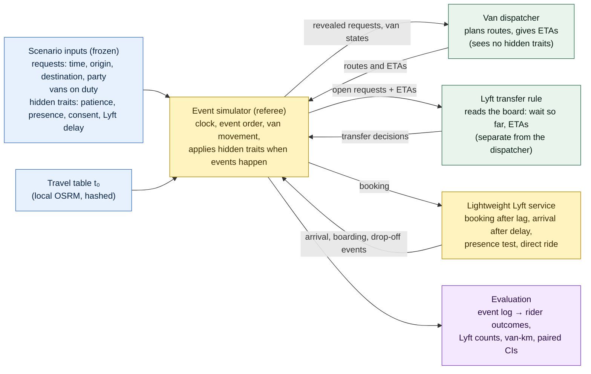

# Scenario-design methodology and build contract (v1.6, 23 Oct 2026)

**What this is.** This document explains how the simulated Night Ride evenings are built from April 2026's aggregate dashboard, what each design choice rests on, and what has to be built next. It is the methodology material planned in Phase 3 plan v4. It reflects the consolidation review of 21 Oct 2026 (decisions D-45 to D-51) and, in v1.1, what the first simulator milestone actually built and verified on 22 Oct (D-51 update, D-52, D-53); v1.2 adds the D-53 decision experiment and the curb-wait convention D-54; v1.3 adds the approval of A and M2; v1.4 adds the research pivot from the proposal (§1a), the L5 pilot and 30-night batch with a descriptive trade-off analysis (§7a), and how the results relate to Pareto and leader–follower framings (§7b). v1.5 is a narrow factual update: the Pushback list no longer says that no rule comparison has run or that D-53 is unsettled, and the §1a reason for holding the dispatcher fixed is stated as a scope choice. v1.6 adds four narrow corrections from the midterm technical review: the patience interpretation of the L5 losses after transfer (§7a), how the 15-minute service measure interacts with transfer timing (§7a, §7b), the leader–follower wording (§7b), and a recorded spec–code difference on the off-duty trigger (§7b limitations). It makes no new modelling decision. v1.0–v1.5 are archived in `archive/`; the methodology PDF (`methodology_pdf/`) is rebuilt for v1.6.

**How to read it.** The core (§1–§9) is meant to be read straight through. The appendices hold the arithmetic, the full reconciliation register and the document map.

**Which document governs what:**

| Question | Authoritative document |
|---|---|
| What was decided, when and why | `decision_log.md` (wins any conflict) |
| What the simulator must do: inputs, states, event order, outputs | `scenario_spec.md` v0.8, especially **§17 (build contract)** |
| The mathematics of the dispatcher and the Lyft rules | `model_design.md` v0.5 |
| What was built and how it was checked | `src/sim/` and §7 of this document |
| An explanatory companion for readers | `methodology_pdf/BlueJay_Scenario_Methodology.pdf` (not authoritative) |
| Why the scenario looks the way it does | this document |
| How results will be judged | `preregistration_v2.md` (draft; criteria not yet approved, D-50) |
| The midterm presentation package | `docs/presentations/midterm/` (deck, script, slide explanations) |

---

## 1. Verdict on the direction
**The direction still supports the research question.** The question is: holding the van dispatcher fixed, which dispatcher-initiated Lyft transfer rule gives riders the best outcomes for the resources it uses (Lyft bookings, van-km)?

The scenario design keeps three things apart:
- **inputs** that are identical for every rule;
- the **policy**, which is the only thing that changes;
- **outcomes**, which only the simulation produces.

That separation is what makes a paired comparison of rules valid.

**Pushback, kept short:**
1. **Rule comparisons so far are descriptive.** Designed validation cases (L1–L4) and a 30-night, two-van pilot of all six Lyft rules (L5; D-56, D-57; §7a) have been simulated. No intervals have been computed and no rule is ranked (D-50 open).
2. **The held-fixed dispatcher is provisionally C** (D-51), conditional on the M5 benchmark. M1 exposed one property of the documented objective: the original pending price could defer the longest waiters. Price A was adopted provisionally to address it (D-53, §7); it remains optimistic when the nearest van is busy.
3. **The 168 requests are a derived workload, not April demand.** The count follows from a load-per-van assumption and a fleet denominator that mixes services. The design is honest about this (an illustrative range of ~150–260), but results must be stated "at the scaled system's density".
4. **Money is out** (D-45). This is the right call: Hopkins' cost per Lyft trip is unknown, and a rider's app showing no charge only says Hopkins pays, not what it pays. Results are about rider outcomes against counts of Lyft bookings and van-km.

---

## 1a. From the September proposal to the current study
The September proposal planned to replay real service nights from trip-level records and to compare dispatch methods head to head (greedy rules, a rolling-horizon MILP and a hybrid), with Lyft as paid overflow inside the optimizer and the published targets as hard constraints. Each of these changed, for a stated reason:

| Proposal | Current study | Why |
|---|---|---|
| Trip-level records "coming" | Only aggregate dashboards (totals, shares, percentiles) | The records did not arrive; every scenario is synthetic and built from aggregates (§4, §5) |
| Compare dispatch algorithms | Compare Lyft-transfer rules with the van dispatcher held fixed | A scope choice: we specify one van dispatcher, modelled on TransLoc's published 2016 design (D-25, D-51), and hold it fixed to isolate the effect of the transfer rule. Synthetic nights do not rule out algorithm comparisons; whether Hopkins' current dispatcher works this way is not verified |
| Lyft as paid overflow inside the MILP | A separate, explicit transfer rule; no money modelled | The JHU page says a dispatcher sends the Lyft; Hopkins' cost per Lyft trip is unknown (D-45) |
| Targets as hard constraints | Reporting thresholds; a ride guardrail max(25 min, 2 × direct + 5 min) | Hard targets would be stricter than the observed service; the targets' wording changed over time (D-47, D-49) |
| Claims about real nights | Claims about synthetic evenings consistent with April's totals, under stated assumptions | §5 |

**Proposal numbers corrected.**
- "About 5,100 rides per hour at 6 pm" is the 30-day total for the 6 pm clock hour (tooltip 5,098; digitized 5,089), about 170 completed rides per evening.
- "About 28 vans" is the "All services" average (27.6, over 29 days), not a Homewood-only count.
- The 20 / 25-minute targets are from the live page read on 21 Oct 2026; pages captured around April 2026 stated 15 / 20 / 20 (D-49).
- "1 in 4 trips overflow to Lyft" is a share of *riders* (24.5% of 44,374 riders, van and Lyft together), not of trips or requests.

The proposal deck itself is kept unchanged as a record.

---

## 2. The system in one picture


**In words:**
- The **simulator** is the referee. It owns the clock and decides what happens, applying each rider's hidden traits only when the relevant event occurs.
- The **van dispatcher** plans from what a real dispatcher could see.
- The **Lyft rule** is a separate module that reads the dispatcher's board. Keeping it separate is what lets us vary the rule while holding the dispatcher fixed.
- The **Lyft service** is deliberately thin: we need *when* a transferred rider is picked up, not how Lyft matches drivers.

---

## 3. What is put in, what is observed, what is hidden, what comes out
| Kind | Examples | Who can see it | Where it comes from |
|---|---|---|---|
| **Input (public)** | Request time, origin, destination, party size; vans on duty | The dispatcher sees a request only once it arrives | Scenario generator, from April aggregates |
| **Input (hidden)** | Patience deadline, presence draw U_r, consent draw, Lyft delay | Only the simulator, and only when the event happens | Scenario generator, separate seeded streams |
| **Policy** | Dispatcher, objective weights, cadence, Lyft rule, lag ℓ | Fixed per run | Policy file |
| **Observed (by the model's agents)** | Waiting so far, current plan, ETAs, pending requests | Dispatcher and Lyft rule | Produced by the simulation as it runs |
| **Produced (outcomes)** | Actual waits, pickups, cancellations, no-shows, transfers, Lyft completions, van-km | Evaluation | The simulation only; never pre-assigned |
| **April evidence (calibration targets)** | Completed / Canceled / No-show shares, wait and ride percentiles, rides per van-hour | The team | The restricted April PDF, via digitized aggregates |

**A scenario blueprint describes inputs and behavioural rules.** Cancellations, no-shows, transfers and completions are things the simulation produces. They are not typed in.

---

## 4. The design chain: evidence → derived quantity → design choice → limitation
| Block | April evidence | Derived quantity | Design choice | Limitation |
|---|---|---|---|---|
| **Arrival window** | Hourly chart of completed rides | Peak at 18:00–21:00 | Requests arrive **18:00–21:00**; the run continues until all accepted work is resolved | The full night (L7) is a later case |
| **Volume** | Requests 50,297; completed 24,095; average vehicles by hour ("All services") | R/C = 2.087; load per van ρ = 12.85 / 10.10 / 10.71 for the three hours | N_h = ρ_h × vans_h, largest-remainder rounding: **64 / 50 / 54 = 168** at 5 constant vans (D-35, D-36) | The vehicle count mixes services, and the chart averages 29 days. **Illustrative ~150–260**, not a confidence interval (D-49) |
| **Timing within the hour** | Hourly totals only | Fixed count per hour | Uniform random times within each hour | Within-hour bunching is not observed; the **burst** pattern stresses it |
| **Fleet** | ~27.6 "All services" vehicles at 6 pm, tapering | — | **5 vans × 14 seats**, constant 18:00–21:00, then on duty until the backlog is done (D-36). The sixth van is tested on the **same** requests (D-37) | A scaled-down system has fewer pooling chances per square mile |
| **Geography** | Density maps with printed bubble counts | 188 hotspot points, 16 zones | Door-to-door at snapped curb points; Homewood + Peabody, no East Baltimore (D-27); **no forced stops** | A bubble stands for many addresses. The dispersed variant spreads the 19 coarse clusters into 6 road satellites each (302 points) to test that (D-34) |
| **O–D pairing** | Origin totals and destination totals per zone, not pairs | Gravity × IPF table that reproduces both margins | Pairs drawn from that table (β_geo = 0.1 per min) | The true pairing is **not identified**: many tables share the same margins |
| **Party size** | 1.386 passengers per completed booking | — | Assumed P(1–5) = .73/.18/.055/.025/.01, mean 1.405 (D-38). Parties of 5 go by **Lyft XL** if transferred (D-33) | The shape is assumed; only the mean is near the data, and the two are different quantities |
| **Patience** | "Canceled" ≈ 47% of requests, which mixes rider cancellations and Lyft hand-offs | A rider share of "Canceled" of **50–75%** (sensitivity, not exhaustive) | A personal deadline (Weibull 1.5, median 18 min **placeholder**); a vehicle arrival ends the clock (D-39) | Patience is **not identified** by aggregates; calibration keeps a set of values, not one |
| **No-shows** | No-show ≈ 4.7% of **all** requests | ≈ 8.9% **per van arrival** under the status mapping | A rider is absent if U_r < p at the first vehicle arrival; **one p for every mode**; 180-s wait (D-40, D-48) | The 8.9% holds only if the mapping holds. Equal p across modes is assumed |
| **Lyft service** | JHU page: the dispatcher sends the Lyft; texts; ≤ 3-min wait | — | Decision → booking after lag 2 min → arrival after a lognormal delay (median 8, P90 15) → presence test → direct ride (D-43, D-46) | No Hopkins data on delays, failures or XL. **No prices** (D-45) |

---

## 5. Why the aggregates cannot pin down one scenario
The April dashboard gives **totals and shares**: requests by status, rides by hour, bubbles by place, a few percentiles. It never shows one rider's request, wait and outcome together. That has three consequences.

1. **Many different nights produce the same totals.** The same zone totals fit many O–D tables; the same hourly counts fit many within-hour patterns. We pick a principled member (maximum-entropy IPF; uniform times) and test stressed alternatives (far-trip, burst, dispersed geography). We do **not** claim it is *the* April night.
2. **Behaviour is confounded with operations.** A long wait followed by "Canceled" could be an impatient rider or a dispatcher hand-off to Lyft. The totals cannot separate them, which is why the rider share of "Canceled" is a 50–75% **range**, and why patience is calibrated to a **set** of values, not a single one.
3. **Shares do not say who.** "4.7% of requests were no-shows" says nothing about which riders, or whether presence depends on how long they waited. The model's per-arrival probability follows from the totals **only under a stated mapping** (Appendix C).

**So the claim the study can make is conditional:** "in scenarios consistent with April's aggregates, rule X does better than rule Y, and this holds across the identified set and the stress patterns." It cannot claim that rule X would have done better on 15 April.

---

## 6. The dispatcher's objective, one block at a time
The van dispatcher chooses one route per van. A route's score is a sum of four penalty terms, in **penalised passenger-minutes** ("points"). Lower is better. **These are priorities, not money.**

**Block 1: waiting, convex.** Each passenger's total wait W (from the original request, so sunk waiting counts) is charged φ(W):

| Wait (min) | 0–5 | 5–10 | 10–15 | 15–20 | > 20 |
|---|---|---|---|---|---|
| Points per extra minute | 1 | 2.5 | 5 | 10 | 20 |

So φ(5) = 5, φ(10) = 17.5, φ(15) = 42.5, φ(20) = 92.5. The longer someone has waited, the more each further minute costs.

**Block 2: riding.** β × ride minutes, with **β = 0.5** points per passenger-minute. With β = 0.5 and φ′ ≥ 1, a waiting minute always outweighs a riding minute.

**Block 3: driving.** γ × route km, with **γ = 0.1** points per km. It is a small tie-breaker that discourages pointless driving.

**Block 4: the ride guardrail.** G_r = max(25 min, 2 × direct time + 5 min). No route may create or increase a ride over G_r. A violation already locked into committed work is charged Ψ (very large) per passenger-minute over the guardrail and logged.

**Leaving a request pending** costs π_r = q_r · φ(W^next) + M, with M large. So the solver first serves as many requests as it can within its candidate routes, then minimises points. A request can still be left pending when routes compete for it or the candidate cap leaves it out. It then keeps a tentative ETA and a logged reason (D-47).

**Symbols:**

| Symbol | Meaning | Unit |
|---|---|---|
| q_r | Passengers in booking r | passengers |
| W_r | Pickup time − request time (either mode) | min |
| H_r | Drop-off − pickup | min |
| t₀(i,j) | Matrix travel time, unscaled | s |
| m_v, m_L | Van and Lyft travel multipliers, each applied once | — |
| φ | Convex wait penalty | points per passenger |
| β, γ | Ride weight; distance weight | points per passenger-min; points per km |
| G_r, Ψ, M | Guardrail; guardrail penalty; pending constant | min; points per passenger-min; points |

### Worked example (dwell omitted for clarity)
One empty van; two open requests:
- **r1:** 1 passenger, has already waited 8 min;
- **r2:** 2 passengers, has waited 1 min.

Both routes below are 10 km.

**Route A: r1 first.** Drive 4 min to r1, 3 min to r2, 5 min to r1's destination, 4 min to r2's.
- Waits: W1 = 8 + 4 = 12; W2 = 1 + 7 = 8.
- Rides: H1 = 3 + 5 = 8; H2 = 5 + 4 = 9.
- Waiting: 1 · φ(12) + 2 · φ(8) = 1 · 27.5 + 2 · 12.5 = 52.5.
- Riding: 0.5 · (1 · 8 + 2 · 9) = 13.0.
- Driving: 0.1 · 10 = 1.0.
- **Total 66.5.**

**Route B: r2 first.** Drive 5 min to r2, 3 min to r1, 5 min to r1's destination, 2 min to r2's.
- Waits: W2 = 1 + 5 = 6; W1 = 8 + 8 = 16.
- Rides: H1 = 5; H2 = 3 + 5 + 2 = 10.
- Waiting: 1 · φ(16) + 2 · φ(6) = 1 · 52.5 + 2 · 7.5 = 67.5.
- Riding: 0.5 · (5 + 2 · 10) = 12.5.
- Driving: 1.0.
- **Total 81.0.**

**The dispatcher picks A.** The rider who has already waited 8 min goes first, even though r2 carries two passengers and B gives slightly less riding. Passenger weighting counts heads; it does not put groups first. The convex φ is what protects the long waiter: in B, r1's wait crosses 15 min, where each minute costs 10 points. Both rides are far below the 25-min guardrail.

---

## 7. Implementation status after M0–M2 (22 Oct 2026)
**What was built** (`src/sim/`, Phase 4 milestone M0–M1; settings D-52 and its amendments):
- `inputs.py`: loads the frozen scenario files read-only and refuses to run if a content hash differs from `FROZEN_v2.json`.
- `engine.py`: the event engine (referee). It owns the clock, the same-second order of spec §17.3, every state, and the hidden rider traits, which it applies only when their event happens.
- `dispatch.py`: dispatcher C. Per van, every subset of ≤ 3 open requests with its best order of all stops (exact), then a set-partitioning MILP solved by HiGHS, with an explicit M bound, exact integer costs, status handling and a canonical tie rule.
- `lyft.py`: the transfer rules. They act at every epoch since M2 (`lyft_window="evening"`); the M0 harness (rules only before 18:15 in L4) stays selectable with `lyft_window="m0"`.
- `run.py`: writes `events.csv`, `epochs.jsonl`, `outcomes.csv`, `run_manifest.json` and a readable `narrative.md` to `outputs/sim/<level>_<rule>/`.

**What was verified** (commands in §8):

| Check | Result | How |
|---|---|---|
| L1–L3 answer keys | Every request's van, curb arrival, pickup, wait, drop-off, ride, no-show time and cancellation time reproduced **to the second**; L3's vans reach the empty curb at the key's time | Engine computes events itself; compared with `handcheck.csv` by two independent test files |
| L4 Lyft mechanics before 18:15 | For each of the five active rule cases, the transfer and decline sets, decision, booking (+120 s), Lyft pickup (+480 s), wait, drop-off and XL class match; **22 transfers (4 XL) and 4 declines in total across the five rule runs** (R1(10) 3+1, R1u(10) 3+1, R2(15) 8+1, R3(2) 8+1, R1(15) none), not counts for one night | Rules act only before 900 s in this harness |
| MILP route selection | All 46 L4 R0 epochs and all L1–L3 epochs solved to proven optimality over the candidate set (gap closed). Under the current default, the MILP's choice equals full enumeration of compatible candidate combinations on all 46 L4 R0 epochs (151,710 combinations), including the canonical choice in the tied epoch and the fewest pending requests. The math review found the same on its runs of L1–L4 and L5/r00 (414 epochs in its run table; its summary says 370), made under the earlier fixed drop order | Independent verification tests; independent math review |
| Best order per subset | For 40 van states of the L4 R0 run, every subset with \|S\| ≤ 2 and a sample of 80 subsets with \|S\| = 3 (1,130 subsets, 113,879 stop orders): each candidate's cost equals the brute-force minimum over all precedence-feasible orders. Not every subset of size 3 was brute-forced | Independent verification tests |
| Invariants | One terminal state per request; no request both in a van route and a Lyft state; capacity; committed pickups served by the committing van; no ride over the guardrail in these runs; event order (with the documented 0-s-leg exception) | Both test files |
| Hidden traits | The observation has no hidden-trait fields; perturbing patience values that never fire leaves plans unchanged | Independent verification tests |
| Reproducibility | Two runs give identical event logs and epoch records (wall times excluded) | Both test files |
| Frozen inputs | Content hashes unchanged; no data written | Tests and `run_manifest.json` |
| Test suite | 253 tests pass on 22 Oct (after M2): 46 pre-existing scenario tests; 39 engine and curb-wait tests (coordinator); 38 independent route tests, 29 independent pending-price tests and 101 independent M2 integration tests (verification agents) | `.venv/bin/python -m pytest -q` |
| Integrated review | Ready to hand to the team once its should-fix items were addressed (all addressed 22 Oct: status labels, plan audit, wording) | `research_notes/m0_m1_integrated_review_2026-10-22.md` |

**What M1 showed on L4 under R0** (a designed validation case; these are simulated outcomes, not evidence about the real service):
- At 18:15 nine requests wait and both vans come on duty. The MILP jointly assigns three to each van (the cap K = 3), sequences them, and leaves three pending with the cap recorded as the reason.
- The plan changes at most epochs while the queue lasts (reassignment of uncommitted requests); committed pickups never move.
- All 16 riders are delivered by 19:10; waits range from 1.2 to 44.4 minutes; the longest ride is 24.9 minutes, within the 25-minute guardrail.
- Run time: about 27 s for the evening (slowest epoch 7.8 s). On L5/r00 (28 requests, with a burst): 86 epochs, all optimal, 25 s. Wall times are diagnostics only; simulated solver latency is zero.

**A property of the documented objective found by M1, and the decision experiment (D-53).** The original pending price charges a waiting request as if it were picked up at the next tick, earlier than any physically possible pickup, so when the cap binds the cheapest requests to defer are often the longest waiters (at 18:15, R002, a party of five who had waited 15 minutes). On 22 Oct the team authorized a bounded experiment: three selectable formulations (original; **A**, priced at the earliest physically possible pickup; **B**, priced after a chosen van route), each run through the whole L4 evening from its own decisions, with everything else identical, plus an independent review with five controlled cases.

| L4 under R0 (16 requests) | Original | A | B |
|---|---|---|---|
| Wait median / P90 / max, min (requests picked up, n = 16) | 17.1 / 31.0 / 44.4 | 18.6 / 31.2 / 35.6 | 21.1 / 34.3 / 38.6 |
| Mean wait, min | 18.8 | 18.8 | 21.8 |
| R002 / R005 / R009 wait | 22:18 / 44:22 / 9:48 | 19:28 / 31:58 / 35:34 | 20:39 / 32:58 / 35:33 |
| Assignment changes | 29 | 27 | 35 |
| MILP time (s) / extra variables | 0.10 / 0 | 0.10 / 0 | 4.8 / up to 9,828 |

A is a lower bound on any future service (with small stated exceptions) and adds nothing to the model; B is an estimate that can err in both directions and grows with requests × candidate routes (135,100 extra variables and 19.6 s for a synthetic five-van, 20-request epoch). **Recommendation: A**, for its meaning and cost, not because of this one night. **Approved provisionally by the team on 22 Oct and now the default** (decision log D-53 approval; design trail §11). Full table and a worked epoch: `outputs/sim/d53_experiment/d53_comparison.md` (regenerate with `cd src && ../.venv/bin/python -m sim.compare`). On runtime: A added no variables and its MILP time was unchanged; total evening runtime differed only because candidate generation followed a different trajectory.

**M2: the Lyft rules with C over the whole L4 evening (22 Oct; D-55).** Each rule ran separately on the same frozen L4 inputs, with R0 as the reference and C using A and D-54. Every epoch was proven optimal over its candidate set. Every request ended in exactly one terminal state. Offers, accepted transfers, bookings and completions reconcile, standard and XL separately. A party of five is always one XL booking. These are simulated outcomes of one designed integration evening; they do not rank the rules.

| L4, 16 requests (29 passengers) | R0 | R1(10) | R1(15) | R1u(10) | R2(15) | R3(2) |
|---|---|---|---|---|---|---|
| Van / Lyft completed | 16 / 0 | 9 / 7 | 11 / 5 | 13 / 3 | 4 / 12 | 4 / 12 |
| Offers: accepted / declined | 0 / 0 | 7 / 1 | 5 / 1 | 3 / 1 | 12 / 1 | 12 / 1 |
| Transfers before / from 18:15 | 0 / 0 | 3 / 4 | 0 / 5 | 3 / 0 | 8 / 4 | 8 / 4 |
| Wait P90, requests picked up (n = 16), min | 31.2 | 20.3 | 25.4 | 22.9 | 13.2 | 11.8 |
| Requests reached within 15 min (of 16) | 5 | 7 | 6 | 7 | 15 | 15 |
| Van-km | 38.0 | 24.6 | 24.9 | 33.8 | 16.5 | 16.5 |

Findings from the logs (thresholds unchanged):
- **R1u(10) transfers nobody after 18:15.** C puts every waiting request into some van's plan within at most 4 minutes, so "continuously unassigned for 10 minutes" never holds while vans are on duty. The rule measures assignment, not waiting.
- **Elapsed-time rules can send a rider to Lyft whose van was predicted sooner.** Under R1(15), R001 is transferred at 18:15 with its van due at 18:17:44, while the Lyft arrives at 18:25.
- **R2(15) and R3(2) are similar but not identical:** they transfer R011 at 18:20 and 18:17 respectively.

Report: `outputs/sim/m2_L4_report.md`, containing the table, one epoch from van ETA through rule trigger and transfer to the re-solved plan, one rider's complete timeline, and the changes for riders who stayed on vans.

### 7a. The L5 pilot and the 30-night batch (D-56, D-57; 22 Oct 2026)
**Design.** L5 is a designed rehearsal level: 30 synthetic one-hour nights, each with 2 vans and 28 requests, 40% of them in a 10-minute burst, plus random patience, presence and Lyft delays.
- **Pairing.** Each night is replayed under all six rules, with identical riders and hidden traits: 180 runs, which are **30 synthetic nights replayed six times, not 180 independent nights**.
- **Settings** (approved for the pilot, provisional): dispatcher C with K = 3, pending price A, curb-wait convention D-54; dispatcher lag 2 min; consent 1.0 (automatic acceptance, a simplification); presence p = 0.089; frozen placeholder patience. The deprecated frozen `p_noshow` is not read.
- **Not the five-van evening.** The five-van evening (L6) is designed but not run.

**Verification.** Every run passed every check. Inputs and configuration were identical across the six arms on all 30 nights, and one code fingerprint covers all runs.
- **Solves.** All 13,663 main solves were proven optimal over their candidate sets.
- **Ties.** 41 epochs had an incomplete tie search (a solver error while looking for equally good plans). For all 41, full enumeration shows a unique optimum, which is the plan chosen.
- **Reproducibility.** 6 sampled reruns were byte-identical to the batch outputs, and the two r00 batch runs were byte-identical to the earlier pilot outputs.

**What happened to transferred riders** (totals over 30 nights). Each row reconciles: transfers = Lyft completed + Lyft no-show + cancelled in the lag + cancelled after booking.

| Rule | Transfers | Lyft completed | Lyft no-show | Cancelled in the lag | Cancelled after booking |
|---|---|---|---|---|---|
| R1(10) transfer after 10 min waited | 196 | 94 | 7 | 18 | 77 |
| R1(15) after 15 min waited | 104 | 55 | 4 | 11 | 34 |
| R1u(10) after 10 min with no van assigned | 8 | 4 | 0 | 1 | 3 |
| R2(15) predicted total wait > 15 min | 294 | 187 | 14 | 14 | 79 |
| R3(2) van predicted later than a Lyft + 2 min | 330 | 211 | 15 | 16 | 88 |

**Mechanisms (verified event behaviour; magnitudes depend on the assumptions).**
1. **A transfer does not stop the patience clock.** The lag and the Lyft delay come on top of the time already waited. Under R1(10), 95 of 196 transferred riders cancelled before their Lyft arrived; under R2(15) and R3(2), about a third did.
   - **Interpretation (corrected in v1.6).** A transfer does not end waiting; riders may still cancel before Lyft arrives. Riders moved by R2(15) and R3(2) had waited less when transferred (median 0 s, against 629 s under R1(10) and 932 s under R1(15)). Under the placeholder patience, where giving up becomes likelier with time waited, that is consistent with their lower share lost after transfer. A conditional calculation on those same riders and delays gives 44–47% against 29–30%, matching the observed shares. It is a possible contributing mechanism, not an isolated cause; the rules also differ in which riders they move.
   - Under constant-hazard patience, elapsed waiting alone does not change the probability of surviving an equal additional waiting period. That does not establish that the cancellation gap between entire policies disappears, because a different patience model would also change who is transferred, when, and who survives in the vans. Whether the policy gap survives other patience shapes is untested.
2. **Assignment is not pickup.** R1u(10) fires only when a request has had no van in the plan for 10 minutes.
   - On L4 it never fired after the vans came on duty (C assigned every waiting request within about 4 minutes).
   - In L5 it fired 8 times on 6 of 30 nights, all for requests made during the burst (18:21–18:28; transfers at 18:35–18:38).
3. **Guardrail excesses come between epochs.** There were 36 excess events across the 180 runs, from 16 distinct requests on 10 nights; the same request repeats under rules that made the same decisions. No plan ever created a violation. The attribution check finds that each coincided with a van no-show on the same van while the rider was aboard, with an excess of at most 150 s per no-show plus a 13-s matrix tolerance. This is consistent with the no-show wait causing the delay; it is not a proof. None was unexplained.
4. **Denominators.** Wait percentiles cover only requests picked up: on average 16.1 of 28 under R0 and 20.2 under R2(15). We therefore also report the share of *all* requests reached by a vehicle (curb arrival, not boarding) within 15 minutes.
5. **The 15-minute measure interacts with transfer timing (added in v1.6).** A request moved under R1(10) has already waited at least 10 min, then faces the 2-min lag and a Lyft delay with median 8 min, so it reaches the curb within 15 min only if the delay is under about 3 min (roughly 2%); under R1(15), never. The waiting-time rules can therefore gain on this measure only by freeing vans, while R2(15) uses the same 15-min threshold as the measure. Measures without a threshold give the same ordering (requests picked up: 20.2–20.4 under R2/R3 against 16.1–17.2; the 90th-percentile wait below). Reporting at 10 and 20 min (spec §4, targets row) has not yet been run.

**Descriptive measures** (averages of nightly values, with the SD across nights; the full table is `outputs/sim/batch_L5_v1/summary.md`):

| Per night | R0 | R1(10) | R1(15) | R1u(10) | R2(15) | R3(2) |
|---|---|---|---|---|---|---|
| Reached within 15 min, share of all 28 | 0.48 (0.09) | 0.51 (0.08) | 0.50 (0.09) | 0.48 (0.10) | 0.73 (0.07) | 0.75 (0.08) |
| Wait 90th percentile, requests picked up (min) | 20.2 (5.3) | 18.1 (2.4) | 19.6 (4.0) | 20.2 (4.6) | 13.3 (1.5) | 12.2 (1.7) |
| Lyft bookings | 0.0 | 5.9 | 3.1 | 0.2 | 9.3 | 10.5 |
| Van-km | 51.2 | 47.6 | 48.6 | 51.9 | 45.7 | 43.0 |

These are simulated outcomes of a designed rehearsal under provisional assumptions. They describe behaviour; they do not rank the rules.

### 7b. Reading the results: trade-offs and leader–follower framings
**Pareto analysis (descriptive, now).** Two objectives are stated explicitly:
- service S = the share of all requests reached within 15 min (larger is better);
- Lyft use B = bookings per night (smaller is better).

Rule P dominates Q if S_P ≥ S_Q and B_P ≤ B_Q, with one strict. The calculation, from saved outputs only (`src/sim/tradeoff.py` → `outputs/sim/batch_L5_v1/tradeoff.md`), gives:
- **On the 30-night means:** R0, R1(15), R1(10), R2(15) and R3(2) are nondominated among the six tested rules. R1u(10) is dominated by R0, narrowly (S 0.476 vs 0.477, about one request in 840, with more Lyft use); no noise margin is applied (D-50), so in practice it is a near tie that uses slightly more Lyft. R0 is nondominated through zero Lyft use alone. The same five remain nondominated with van-km as a third objective.
- **Night by night:** R2(15) and R3(2) reach more than R0 on all 30 nights; R1(10) on 19, but fewer on 6.

Three trade-offs are kept separate:
1. The fixed weights inside C's routing objective (§6).
2. The empirical trade-off between transfer rules (this analysis).
3. The decision criteria for choosing a rule (D-50, not approved).

Nondominated among six tested rules is neither a frontier of all policies nor a recommendation. Because the service measure favours early transfer (§7a, mechanism 5), another measure or decision criterion could change the assessment. Still to come: paired intervals once D-50 is decided, threshold sweeps to trace curves, calibrated behaviour, and five vans.

**Leader–follower (a possible extension, not implemented).** One possible extension is to optimize transfer policy while anticipating how the routing dispatcher responds. A bilevel formulation is a modelling choice: a threshold could also be tuned by simulation-based search with the dispatcher as a black box. One reading has a leader, the policy designer choosing rule parameters θ, and a follower, the routing optimizer responding to the requests left after transfers. As a bilevel program:

  min over θ of E[L(θ, y) + λ·B(θ)]  subject to  y ∈ argmin over y′ ∈ Y(θ) of f(y′; θ)

What we implement is a sequential policy simulation: per epoch, plan → the rule reads the plan → transfers → one re-plan, with six fixed rules compared by replaying nights. A finite exhaustive search over a defined set of θ values, with the follower defined as our deterministic per-epoch restricted MILP and its tie rule, would identify the best option within that finite set for the stated objective averaged over the sampled nights; it would not establish optimality over continuous thresholds, over all policies, or for the true expectation. To make the bilevel formulation precise we would still need to define (corrected in v1.6):
- the leader's decision space (rule family; discrete or continuous θ; bounds);
- the follower: a sequence of per-epoch restricted MILPs whose state depends on earlier epochs and random outcomes, or one whole-evening problem, with its information and timing;
- how non-unique follower optima are treated (optimistic or pessimistic; ours uses a fixed canonical tie rule, D-52, which is neither);
- the expectation (a scenario distribution, or a sample average over N nights);
- the loss L and the weight λ (D-50 open);
- any upper-level constraints, such as a Lyft budget or a service floor.

Any single-level reduction would need specific assumptions and justification, and we claim none. Riders (fixed patience rules) and Lyft (a delay distribution) are not modelled as optimizing players. Terminology follows von Stackelberg (1934), Colson, Marcotte & Savard (2007) and Dempe (2002).

**Status by item:**

| Status | Item |
|---|---|
| **Implemented and verified** | Event engine for L1–L4 events (requests, movement, boarding, drop-offs, curb waits and no-shows, designed cancellations, commitment, periodic re-planning, backlog completion); dispatcher C with pending price A (approved provisionally); curb-wait convention D-54; the Lyft rules all evening on L4 with the full transfer lifecycle (M2); logs, narratives and reports |
| **Implemented, provisional** | All D-52 settings (K = 3, Ψ = 1000, solver budget, tie rule); p = 0.089 presence (L1–L4 do not depend on it); the engine conventions in spec §17.9 |
| **Implemented (M3 pilot, 22 Oct)** | L5 pilot settings in the run configuration (D-56); resumable 30-night batch with per-run checks (D-57); descriptive trade-off analysis of saved outputs |
| **Documented only** | Decision criteria and paired intervals (D-50, not approved); pre-registration |
| **Not started** | Heuristic T; hindsight H; L6/L7 builders; calibration; the M5 benchmark; the experiment grid |

**Limitations to keep in view:**
- C is optimal **over its candidate set at each epoch, subject to solver status**; it is not optimal over all routes or over the evening, and it is myopic.
- K = 3 is a tractability choice for pure Python; it shapes ETAs and pending status, so it is part of the held-fixed dispatcher.
- Guardrail excesses can still arise between epochs (after a no-show wait, or where the travel matrix breaks the triangle inequality by up to 12.7 s). None occurred in the L1–L4 runs. In the L5 batch, 36 excess events occurred (16 distinct requests on 10 nights), each attributed by the check to a van no-show on the same van during the ride (§7a); none was unexplained.
- During an absent rider's curb wait the planner now keeps the pickup committed and plans for possible boarding at expiry (D-54, adopted 22 Oct; planning only, not Hopkins policy).
- Shift ends (tapering, L7) are not implemented; the rule's wording is open (spec §17.6).
- **Off-duty trigger: spec and code differ (open, recorded in v1.6).** Spec §17.4 and D-46(3) list a van going off duty as an epoch trigger. The simulator (`src/sim/engine.py`, the off-duty handler) only logs the off-duty time (as deferred while any request is unresolved) and opens no epoch; it never takes a van off duty, so in effect vans stay on duty until the run ends, consistent with the closing rule (D-36, §17.6). The simulator is unchanged; whether the difference affected any L1–L5 decision has not been checked. To be settled with the shift-end rule before L7.

---

## 8. Recommended next step, and how it grows
### The dispatcher decision (D-51, provisionally made 21 Oct)
C, the restricted route-selection MILP, is the dispatcher the team intends to hold fixed, conditional on the M5 benchmark. It shares the published structure of TransLoc's dispatcher; it does not reproduce Hopkins' proprietary dispatcher. T (insertion + local search) is a development contingency or a later robustness variant, **never a runtime fallback**. A solve that ends with no incumbent (`failed`) executes committed work only and is logged; one that reaches the node budget executes its best incumbent, labelled `feasible_unproven`; a HiGHS error, an infeasible model or the wall-clock safety stop ends the run with an error (D-52 amendments 2–3). None of these occurred in the M0–M1 runs.

### How to inspect the M1 demonstration
```bash
cd src && ../.venv/bin/python -m sim.run --level L4 --rule R0
```
Then read `outputs/sim/L4_R0/narrative.md` (requests, van movements, plan changes, the 18:15 comparison and a small worked example); the machine-readable detail is in `epochs.jsonl` and `events.csv`. Tests:
```bash
.venv/bin/python -m pytest -q tests/test_sim_engine.py tests/test_sim_independent.py
```

### How to inspect the M2 demonstration
```bash
cd src && for r in R0 "R1(10)" "R1(15)" "R1u(10)" "R2(15)" "R3(2)"; do ../.venv/bin/python -m sim.run --level L4 --rule "$r"; done; ../.venv/bin/python -m sim.m2_report
```
Then read `outputs/sim/m2_L4_report.md`; each run's detail is in `outputs/sim/L4_<rule>/` (`narrative.md`, `events.csv`, `epochs.jsonl`).

### M3 status and its remaining step
The L5 pilot (D-56) and the 30-night batch (D-57) are **done** (§7a). The remaining step is the paired-interval analysis of the **saved** outputs, which needs no new simulation. Its entry decision is D-50: which primary metric, which margins, and the power target. It will show the interval machinery working and the night-to-night variance the power check needs. With two vans and placeholder behaviour it supports no conclusion about the real service.

### How to inspect the pilot and batch
```bash
cd src && ../.venv/bin/python -m sim.batch summary && ../.venv/bin/python -m sim.tradeoff
```
Then read `outputs/sim/batch_L5_v1/summary.md` and `tradeoff.md`.

### How it grows to the five-van demonstration
| Milestone | Adds | Shows |
|---|---|---|
| ~~M0–M1~~ | ~~Referee; C on L4 under R0~~ | **Done 22 Oct** (§7) |
| ~~M2~~ | ~~The Lyft rules all evening with C on L4~~ | **Done 22 Oct** (§7, D-55) |
| M3 | L5, 30 nights × 6 rules | **Batch done 22 Oct** (§7a); paired intervals wait on D-50 |
| M4 | The L6 builder, 64 / 50 / 54 (new scenario generation; needs go-ahead) | Inputs for the demonstration |
| M5 | First hour only: 5 vans, 64 requests; **benchmark** | Whether C fits the budget, which **confirms or overturns D-51** |
| M6 | The full 168-request, five-van demonstration | One traced evening, end to end |
| M7 | The experiment grid | The research answer |

---

## 9. Open decisions for the team
1. ~~D-53~~: A approved provisionally (22 Oct).
1a. ~~L5 policy settings~~: approved for the pilot (D-56).
1b. **D-50: decision criteria** (primary metric, margins, power target) before paired intervals are computed.
1c. ~~Midterm timing~~: confirmed as a 30-minute slot; the presentation is planned at about 27 minutes (midterm package v0.4).
2. ~~Curb-wait convention~~: settled by D-54 (22 Oct).
3. **Review of the provisional D-52 settings** (K = 3, Ψ, solver budget, tie rule) and of the proposed conventions D-46, D-47(2), D-48, D-50.
4. **Later, not now:** accepting the dashboard status mapping that pins p ≈ 8.9% (Appendix C), and the calibration targets.

---

# Appendices

## A. Reconciliation register (21 Oct 2026)
**Classes:** **R** = resolved in the documents; **B** = transparent base assumption; **S** = deferred sensitivity; **X** = genuine implementation blocker.

| Issue | Class | Resolution | Where |
|---|---|---|---|
| Financial modelling | R | Removed; operational counts only; standard vs XL; no offer stage at p_c = 1 | D-45 |
| Travel multiplier applied twice | R | One base t₀; m_v and m_L each once; generator rounding | D-47; spec §17.1 |
| False pending claim | R | Corrected; cap relative to the previous plan; single-insertion coverage; tentative ETA; pending reason logged | D-47 |
| Guardrail hard vs penalised | R | No new or increased violation; Ψ only for unavoidable ones | D-47 |
| M, Ψ, gap values | X (small) | Gap 0 relative, small absolute; M and Ψ set and recorded at first MILP build, before comparisons | D-47 |
| Latency | R | Zero simulated latency; deterministic budgets | D-46 |
| Same-second event order | R | Class order 10–90; one epoch per second | D-46; spec §17.3 |
| Transfer commitment and the lag | R | Leave van planning at the decision; `xfer_hold`; cancel in the lag gives no booking | D-46; spec §17.5 |
| Commitment timing | R | At departure | D-46 |
| Backlog completion vs L5 shift end | R | Closing rule; L5 `avail_end_s` read as the window end; g = 0 | D-46 |
| `lyft_failed` missing | R | Added (sensitivity only, f = 0) | spec §5 |
| No-show denominators | R | 4.7% of all requests vs ≈ 8.9% per arrival under the mapping | D-48; App. C |
| Frozen 0.047 fields | R | Errata; the simulator must not read them | D-48; spec §17.7 |
| Shared presence draw | B | One U_r, one p for every mode, time-independent | D-48 |
| Separate van / Lyft / XL presence | S | Deferred | D-48 |
| Presence depending on wait (silent abandonment) | S | Deferred | D-42 |
| Service targets | R | April-era wording 15/20/20 kept distinct from the live 20/25/25 reading; no inferred policy | D-49 |
| Statistical language | R | Non-inferiority margins; "CI contains 0" is not "not worse" | D-50 |
| Survivor-biased primary metric | R | Share not reached within 15 min, counting every request | D-50 |
| Cross-pattern pairing | R | Not paired; H2 marked unpaired | D-49 |
| Illustrative range | R | ~150–260; 29 days, not 30 | D-49 |
| 50–75% rider share of "Canceled" | B | Sensitivity range, not exhaustive | D-39, D-49 |
| Hourly chart read by request hour | B | Transparent assumption | D-49 |
| Unused frozen columns | R | `lyft_noshow_u`, `eta_noise` kept for compatibility; no regeneration | D-41; spec §17.7 |
| Notation collision (L_r) | R | Guardrail renamed G_r; Lyft delay λ_r | model_design v0.2 |
| Dispatcher algorithm | R | C provisionally selected, conditional on M5 (21 Oct) | D-51 update |
| Pending price defers long waiters | R (provisional) | A approved provisionally and made the default (22 Oct) | D-53 approval; trail §11 |
| Lyft rules interacting with C all evening | R | Implemented and verified on L4 (M2) | D-55 |
| Curb-wait planning view | R | Possible boarding at expiry, planning only | D-54 |
| Candidate rule, K, M, Ψ, solver budget, ties | R (provisional) | Fixed before any comparison | D-52 and amendments |
| L4 counts in the phase log ("28" / "32") | R | Correct figure: 22 transfer decisions (4 XL) and 4 declines | phase3 log, 21 Oct |

## B. Volume arithmetic
- R/C = 50,297 ÷ 24,095 = 2.087. Requests here are Completed + Canceled + No-show, with Denied read as 0.
- For each clock hour h: ρ_h = (C_h / 30) × R/C ÷ V_h, which gives 12.85 / 10.10 / 10.71.
- With 5 vans each hour: 64.25 / 50.50 / 53.55, which sums to 168.3. Largest-remainder rounding:
  - round the total to 168;
  - floor each hour to 64 / 50 / 53;
  - give the last unit to the hour with the largest fraction (0.55), so **64 / 50 / 54**.
- **Sensitivity (illustrative):**
  - if Homewood had 20–35% fewer vehicles than "All services", ρ rises by 1/0.8 to 1/0.65, giving ≈ 210–260;
  - ~10% rebookings would lower the count to ≈ 150;
  - the 29-day chart moves ρ by about ±3%.

## C. No-show identification
**The mapping assumed:**
- Completed = van-completed;
- "No Show" is recorded only after a real van arrival;
- Lyft hand-offs are recorded as "Canceled".

**Arithmetic:**
- Van arrivals ≈ completed + no-shows = 24,095 + 2,359 = 26,454.
- So p ≈ 2,359 / 26,454 ≈ **8.9%** per van arrival.
- Under the same mapping, 2,359 / 50,297 ≈ **4.7%** of all requests.

The arithmetic is exact; the uncertainty is entirely in the mapping. If some Lyft no-shows were recorded as "No Show", or some completed rides were Lyft trips, p moves. Patience is not identified by these numbers.

## D. Feasibility: what is known and what a benchmark must measure
**Known:**
- matrix sizes: 188 points (v2) and 302 points (dispersed);
- 168 requests and 5 vans in the demonstration;
- the 120-s tick, i.e. 90 ticks over three hours plus event epochs, before the backlog;
- HiGHS available, MIT licence, deterministic with `threads=1` and a fixed seed.

**Estimates only:** per-epoch solve times and night totals in `compute_feasibility.md`.

**The M5 benchmark must measure:**
- epochs per night;
- open requests and candidates per van per epoch;
- MILP rows, columns and non-zeros;
- solve time (median, P99, max);
- the share of epochs that hit the node limit or end with a non-zero gap;
- total wall time and peak memory per night;
- determinism (identical event logs on repeat runs);
- whether raising the candidate cap changes any plan (a coverage check).

## E. Document map and cross-references
| Document | Version | Status after this review |
|---|---|---|
| `decision_log.md` | — | D-45–D-51 added; D-44 financial part and trail §10 superseded; D-41 simplified |
| `scenario_spec.md` | v0.8 | §17.9 adds the L5 pilot settings, tie-search labelling and guardrail attribution (v0.7 archived) |
| `model_design.md` | v0.5 | Pending price A approved; Lyft module as implemented (v0.4 archived) |
| `preregistration_v2.md` | draft, revised 21 Oct | Statistics corrected (20 Oct draft archived) |
| `research_review.md` | v1.0 | Annotated in place |
| `src/sim/` | M0–M3 pilot | Event engine, dispatcher C, Lyft rules all evening, runner, reports, batch (`batch.py`), trade-off (`tradeoff.py`) |
| `docs/presentations/midterm/` | draft v0.1 | Midterm deck, speaking script, slide explanations, figure and number scripts |
| `research_notes/m1_math_review_2026-10-21.md` | — | Independent math review of C |
| `methodology_pdf/` | draft | Explanatory companion PDF (not authoritative) |
| `team_config.v2.json` | v2.1 | `simultaneous_event_order` superseded by spec §17.3 (not edited) |
| `compute_feasibility.md` | v0.1 | Environment section stale; estimates unverified (not edited) |
| `research_notes/design_review_*_2026-10-21.md` | — | The three review notes behind this document |

## F. Alignment with the project compass
No compass file exists. The draft discussed earlier states the question as "…at what resource **cost**…". Under D-45 that should read "**resource use** (Lyft bookings, van-km)". Otherwise the draft matches this document: the question, the scope (Homewood + Peabody, no East Baltimore, no stop experiment), and the scenario-blueprint-first sequencing. No compass was created.
